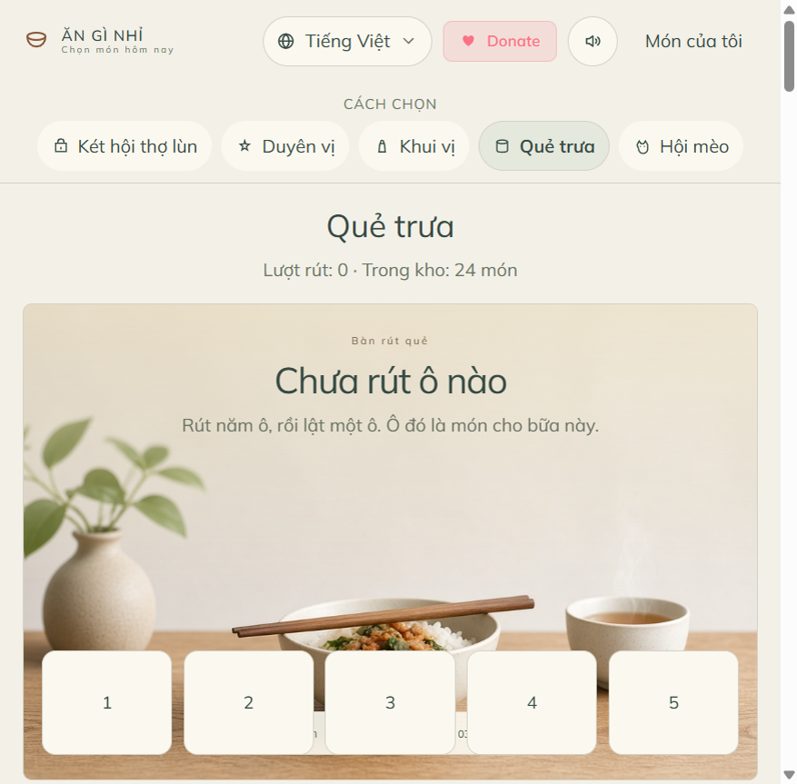

<div align="center">
  <h1>Ăn gì nhỉ</h1>
  <h3>Chọn món hôm nay, rồi tìm quán gần đây</h3>
  <p>Lọc kho món trên máy bạn, rút một lần, mở Google Maps / Grab / ShopeeFood. Không tài khoản, không backend.</p>

  <p>
    <a href="#tính-năng">Tính năng</a> ·
    <a href="#cài-đặt">Cài đặt</a> ·
    <a href="#kiến-trúc">Kiến trúc</a> ·
    <a href="#đóng-góp">Đóng góp</a> ·
    <a href="#ủng-hộ">Ủng hộ</a>
  </p>

  <p>
    <a href="LICENSE"></a>
    <a href="https://www.youtube.com/@nhmanhAI42E"></a>
    <a href="https://t.me/AI42E"></a>
  </p>
</div>

<br/>

<div align="center">
  
</div>

> Đứng trước tủ lạnh mà không quyết được thì rút một quẻ — rồi đi tìm quán, không phải đọc menu dài.

---

<a id="tính-năng"></a>

## ✨ Tính năng

<table>
<tr>
  <td align="center" width="25%"><h3>Lọc món</h3><p>Loại, xuất xứ, vùng, suất, chay, ngân sách</p></td>
  <td align="center" width="25%"><h3>Quẻ trưa</h3><p>Chia năm ô, lật một ô, khui ra món</p></td>
  <td align="center" width="25%"><h3>Tìm quán</h3><p>Maps, Grab, ShopeeFood theo khu vực</p></td>
  <td align="center" width="25%"><h3>Món của tôi</h3><p>Ẩn món sẵn, thêm món của mình trên trình duyệt</p></td>
</tr>
</table>

---

<a id="cài-đặt"></a>

## ⚡ Cài đặt / Chạy

Cần Node ≥ 22.12 và pnpm 10 (qua corepack).

```sh
corepack enable
corepack pnpm install
corepack pnpm dev
```

Mở [http://127.0.0.1:5173/](http://127.0.0.1:5173/). Kiểm tra: `corepack pnpm typecheck` · `corepack pnpm test` · `corepack pnpm build`.

---

<a id="kiến-trúc"></a>

## 🏗️ Kiến trúc

Một trang Vite + React 19. Catalog trong source, state trong `localStorage` `anginhi-v1`. Không API. Chi tiết: [docs/ARCHITECTURE.md](docs/ARCHITECTURE.md). Việc người dùng làm được: [docs/FEATURES.md](docs/FEATURES.md).

Bản dịch zh / ko / ja / hi đang được bổ đủ; nhận PR sửa câu.

---

<a id="ủng-hộ"></a>

## 💜 Ủng hộ

<div align="center">
  
  <br/><sub>Quét QR ủng hộ một ly cà phê ☕ — giúp tool tiếp tục miễn phí.</sub>
</div>

## 💬 Liên hệ / Cộng đồng

- YouTube: [@nhmanhAI42E](https://www.youtube.com/@nhmanhAI42E)
- Facebook: [nhmanhAI4E](https://www.facebook.com/nhmanhAI4E/)
- Telegram: [@AI42E](https://t.me/AI42E)
- GitHub: [nhmanhDev](https://github.com/nhmanhDev)
- Email: [nhmanh.dev@gmail.com](mailto:nhmanh.dev@gmail.com)

<a id="đóng-góp"></a>

## 🤝 Đóng góp

Xem [Contributing Guide](CONTRIBUTING.md) — setup, code style, PR vào `dev`. Báo lỗi bảo mật: [SECURITY.md](SECURITY.md).

---

## 📜 License

Ăn gì nhỉ phát hành theo [Apache License 2.0](LICENSE). Dùng, sửa, phân phối được, kèm điều khoản sáng chế.

## 🙏 Ghi nhận

| Project | Role |
|---|---|
| Ảnh món trong `public/food/` | Nguồn ghi ở [public/food/CREDITS.txt](public/food/CREDITS.txt) |
| Donate / modal | Pattern từ [DownloadAnything](https://github.com/nhmanhDev) / AI42E |
